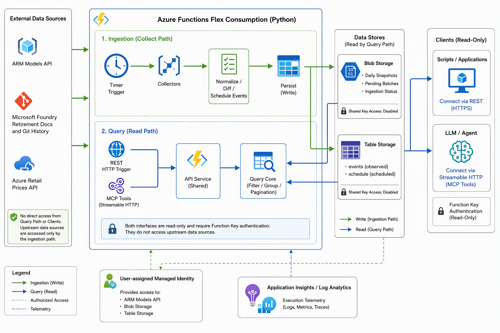

# 架构与设计

[English](architecture.md) | **简体中文** | [README](../README.zh-CN.md)

## 系统概览

Foundry Notifier 是一个基于快照的变化追踪服务。定时任务采集模型目录、退役文档与零售价格，把快照差异和已公布的日期转换为可查询的事件。REST 与 MCP 客户端读取同一份已保存的结果；查询不会触发采集，也不会实时请求上游数据源。

系统运行在一个 Azure Functions Flex Consumption 应用中，采用 Python v2 编程模型。Azure Blob Storage 保存快照与采集状态，Azure Table Storage 保存事件，用户分配的托管身份负责访问 ARM 与存储。

## 系统组成

图中表示逻辑数据流，不代表新增服务：采集流水线、API service 与查询逻辑都是同一个 Function App 内的模块。客户端仅通过 REST 或 MCP 访问数据，存储读取由 API service 负责，query core 处理已读取的数据。没有基于队列的业务流水线，也不需要独立部署 MCP Server。

| 组件 | 职责 |
|---|---|
| Timer trigger | 按 `DAILY_COLLECT_SCHEDULE` 启动采集，默认每天 UTC 00:00 / 北京时间 08:00。 |
| Collectors | 处理各来源的网络 I/O、认证、分页与重试。 |
| Core 数据处理 | 标准化记录、比较快照、推导计划事件，用确定性规则解析价格计量。 |
| 采集流水线 | 编排各来源步骤、故障恢复、持久化与来源级健康状态。 |
| Blob Storage | 保存压缩的每日快照、最新快照索引、待提交批次与采集状态。 |
| Table Storage | `events` 保存观测事件，`schedule` 保存已公布日期的计划事件。 |
| API service 与 query core | 读取已存数据，共用窗口、过滤、分组与分页规则，并附加采集健康信息。 |
| HTTP 与 MCP triggers | 认证并把请求适配到同一查询服务，两种接口均只读。 |
| Application Insights / Log Analytics | 记录执行遥测、失败与降级警告；可选告警监控采集失败或长时间未完成。 |

## 数据来源与权威边界

| 来源 | 用途 | 重要边界 |
|---|---|---|
| ARM Models API | 模型版本、区域可用性、SKU 状态、退役日期、替代模型与自动升级日期的主数据源。 | 是订阅视角，不是全局完整目录；动态发现区域并读取所有分页。 |
| Microsoft Foundry 退役文档 | 日常读取 [Learn 发布页](https://learn.microsoft.com/en-us/azure/foundry/openai/concepts/model-retirement-schedule)，优先 Markdown，失败回退 HTML；GitHub 仅用于首次历史尽力回填。 | 可能滞后于 ARM 或与之不一致，保留事件来源，不静默选择某一日期。 |
| Azure Retail Prices API | 当前 token 零售价与 PTU 小时价，通过每日快照积累价格变化历史。 | 没有通用的历史价格或未来价格数据流；不覆盖 Anthropic 等 Marketplace 价格。 |

ARM 只采用 `kind` 为 `AIServices` 与 `MAI` 的记录，避免重复目录视图。模型标识为 `(format, name, version)`，SKU 标识为 `(name, scope)`，保留区域差异。需要 Marketplace 的模型仍纳入生命周期追踪；HuggingFace / managed compute 不在范围内。

价格与 ARM 之间没有可靠的共同 meter ID。系统用规则词典解析 token 计量，统一换算为 USD / 1M tokens，再通过别名与保守的名称匹配关联模型。关联不确定时保留 `mapped=false`；无法解析时保留 `unparsed=true`，退回逐计量事件而不猜测维度。两种情况都不丢弃数据。采集与价格解析不在运行时调用 LLM。

## 采集与发布流程

每次运行依次执行 ARM、docs、prices 三个步骤，各自隔离失败。每个来源按以下流程处理：

1. 标记正在采集，在请求新数据前重放已保存的待提交批次。
2. 采集并标准化快照，与早于今天的最近一份已发布快照比较，基线不一定是昨天。
3. 从差异生成 `observed` 事件，从已公布日期生成 `scheduled` 事件。
4. 在改动事件表前，保存包含快照与事件的待提交批次。
5. 替换该来源当天的观测事件，并对账计划事件。
6. 发布快照、更新最新索引、删除待提交批次，再记录来源健康状态。

ARM 与价格的首份快照只建立基线，不把整个目录报告为新上线。文档首次采集可通过近期 Git 历史回填；回填失败不阻断当天采集。

文档必须包含完整五列表头及已知生命周期。空结果或既有行键丢失超过 20% 时在提交前拒绝，保留最后成功快照和计划；下载诊断包含来源 URL、HTTP 状态与失败阶段。只有 include 引用的 Markdown 不视为有效日程，也不会将当前 Learn 页面冒充 Git 历史版本。

### 存储布局

以下路径都位于 `snapshots` Blob 容器内：

| 路径或表 | 内容 |
|---|---|
| `YYYY-MM-DD/{arm,docs,prices}.json.gz` | 已发布的每日快照。 |
| `latest/{source}.json.gz` | 最新和前一日期已发布快照的引用，常规读取不必枚举全部 Blob。 |
| `pending/YYYY-MM-DD/{source}.json.gz` | 可重放的未完成采集批次，普通快照查询忽略它们。 |
| `status/{source}.json.gz` | 最近的来源采集状态与时间戳。 |
| `runs/YYYY-MM-DD/{source}.json.gz` | 每天最后一次尝试的报告，不是逐次执行审计日志。 |
| Table `events` / `schedule` | 按日期分区，以确定性事件 ID 为行键；大型事件正文分片保存到多个属性。 |

### 可靠性边界

- 文档或价格失败不阻止其他来源提交。所有步骤结束后，若有来源或状态写入失败，Timer 才最终报告失败。
- ARM 某区域失败时，尽可能沿用最近已发布的区域数据并标为过期，避免短暂区域故障被误报为大量模型下线。如果所有区域都未返回有效目录，不发布新的 ARM 快照。
- 部分区域缺失属于 `degraded`，不算调用失败；客户端仍收到 `collection.complete=false` 与受影响区域。
- 确定性事件 ID 和按来源、日期替换保证重跑幂等。未来计划消失时撤回，今天及更早的计划保留为历史。
- Blob 与 Table 之间没有分布式事务，提交期间可能短暂看到部分事件。待提交批次重放可恢复中断的发布，不提前推进快照基线。
- 采集依赖单写者，不应让手动采集与 Timer 重叠执行。

## 事件与查询模型

每个事件都记录 `source`（`arm`、`docs` 或 `retail_prices`）、`kind`（`observed` 或 `scheduled`）和 `category`（`lifecycle` 或 `price`）。

`observed` 表示在两份快照间发现变化，不意味着变化恰好发生在采集时刻。典型事件包括新版本、Preview 转 GA、区域或 SKU 变化、退役日期变更与价格变化。`scheduled` 表示来源公布了生效日期，例如退役或自动升级开始，不证明变化已经发生。

时间戳统一按 UTC 存储与比较，查询日界使用 Asia/Shanghai：

| 查询 | 窗口与内容 |
|---|---|
| 今天 | 当天观测事件，加上日期为今天的计划事件。 |
| 过去 N 天 | 今天之前的 N 天，不含今天，包含两种事件。 |
| 未来 N 天 | 今天之后的 N 天，不含今天，只含计划事件。 |
| 模型 / 价格 | 最近已发布快照，不是上游实时响应。 |

变化按模型分组，相同的多区域变化聚合展示。事件流水不抵消为净变化：先涨价再降价仍保留两个事实。计划退役与对应的实际退役观测可以互相关联，但两条事实都保留。

两种接口通过查询核心共用过滤条件与返回结构。变化响应受条数与字节数双重限制，提供 `truncated` 和续页游标，大型价格明细可跨页。完整分页契约见 [API 与 MCP](api.zh-CN.md)。

快照读取在进程内缓存 10 分钟，采集状态缓存 15 秒。成功查询附带 `collection` 信息，帮助客户端区分“没有变化”和“采集缺失、过期或不完整”。它描述当前采集覆盖度，不保证历史窗口中每一天都完整。

## 安全与部署

客户端认证和后端授权是两个独立边界：

| 边界 | 机制 |
|---|---|
| 客户端 -> REST | Function 级认证，每个调用方使用命名 host key，通过 `x-functions-key` 传入。 |
| 客户端 -> MCP | `/runtime/webhooks/mcp` 上的 Streamable HTTP，使用 `mcp_extension` system key，webhook 保持 System 级授权；不启用 SSE。 |
| Function App -> ARM | `DefaultAzureCredential` 使用用户分配的托管身份，授予订阅 Reader。 |
| Function App -> Blob / Table | 使用身份与存储数据 RBAC 授权，禁用存储共享密钥访问。 |
| 本地开发 -> Azure | `DefaultAzureCredential` 使用开发者凭据；Azurite 是显式启用的本地替代方案。 |

对外两种接口均不开放匿名访问，也不提供写操作或触发采集能力。不得分发 master key。Function Key 是共享秘密而非用户身份：REST 可按调用方轮换，MCP system key 轮换会影响所有 MCP 客户端。

`azd` 与适用于 Cloud Shell 的部署脚本使用同一套 Bicep 基础设施：资源组、Function App 与 Flex plan、用户分配的托管身份、存储账户、Application Insights、Log Analytics 和 RBAC 分配。可选采集告警检测执行失败与长时间未完成，不检测区域完整性。应用没有内置限流器，Flex 实例上限约束的是扩容而非请求速率。

## 设计取舍与局限

- 每日快照以非实时采集换取可重复比较与低开销只读查询。ARM 和价格历史从首份基线之后开始积累。
- 未来变化依赖已公布日期，不能预测未发布模型或价格；只有来源实际提供未来生效条目时，才能生成未来价格事件。
- 保留来源便于判断订阅可见性、文档分歧与零售价发布延迟。价格是零售标价，不代表协议折扣或实际账单。
- 网络 I/O 与纯函数分离，便于离线 fixture 测试；共享查询核心避免 REST 与 MCP 出现不同事件语义。

## 实现位置

| 代码 | 职责 |
|---|---|
| [function_app.py](../src/function_app.py) / [pipeline.py](../src/pipeline.py) | 触发器注册与采集编排。 |
| [collectors](../src/collectors/) | 上游网络访问。 |
| [core](../src/core/) | 标准化、生命周期与价格 diff、计划推导、文档解析及配置。 |
| [store.py](../src/core/store.py) | Blob/Table 持久化、发布、恢复与存储查询。 |
| [query.py](../src/core/query.py) | 共享的事件与目录查询语义。 |
| [api](../src/api/) | 基于存储的查询服务与 REST/MCP 适配层。 |
| [infra](../infra/) | 共用的 Bicep 部署。 |

使用方法见 [API 与 MCP](api.zh-CN.md)，操作步骤见 [部署与运维](deployment.zh-CN.md)，本地环境与测试见 [开发指南](development.zh-CN.md)。详细设计记录与数据源调研保留在 [项目规划](plan.md)。